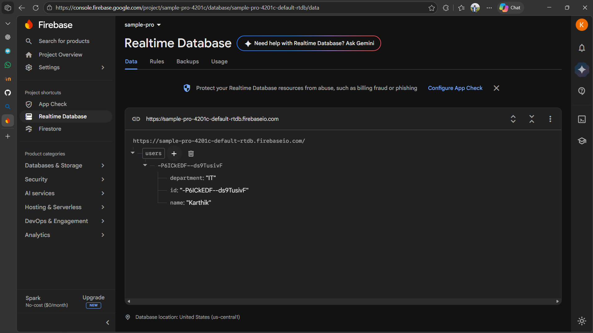

# Develop an android application to add, modify and delete employee details (Name , Age and Salary )using Firebase Real Time Database.

## AIM

To develop an Android application using Java and XML that connects to Firebase Realtime Database and retrieves and displays employee details stored in the Firebase database.

## PROCEDURE

1. Open Android Studio and create a new Android project.
2. Select the Empty Views Activity template.
3. Enter the project name and select Java as the programming language.
4. Open the Firebase Console and create a new Firebase project.
5. Register the Android application in the Firebase project using the package name.
6. Download the `google-services.json` configuration file.
7. Place the `google-services.json` file inside the app module directory.
8. Add the required Firebase dependencies and Google Services plugin in the Gradle files.
9. Open Firebase Console and enable Firebase Realtime Database.
10. Create an employee node in the database and enter employee details such as Employee ID, Name, Department and Salary.
11. Design the application interface using `activity_main.xml`.
12. Write Java code in `MainActivity.java` to connect to Firebase Realtime Database and retrieve employee details.
13. Use a Firebase Database Reference and a ValueEventListener to read the employee records.
14. Display the retrieved employee details in the Android application using suitable UI components.
15. Run the application on an Android Emulator or physical Android device.
16. Verify that the employee details are displayed correctly.

## PROGRAM

### MainActivity.java

```java
package com.example.myapplication;

import android.os.Bundle;
import android.text.TextUtils;
import android.view.View;
import android.widget.Button;
import android.widget.EditText;
import android.widget.TextView;
import android.widget.Toast;

import androidx.activity.EdgeToEdge;
import androidx.annotation.NonNull;
import androidx.appcompat.app.AppCompatActivity;
import androidx.core.graphics.Insets;
import androidx.core.view.ViewCompat;
import androidx.core.view.WindowInsetsCompat;
import androidx.recyclerview.widget.LinearLayoutManager;
import androidx.recyclerview.widget.RecyclerView;

import com.google.firebase.database.DataSnapshot;
import com.google.firebase.database.DatabaseError;
import com.google.firebase.database.ValueEventListener;

import java.util.ArrayList;
import java.util.List;

public class MainActivity extends AppCompatActivity implements UserAdapter.OnUserDeleteListener {

    private EditText etName;
    private EditText etDepartment;
    private Button btnSave;
    private Button btnClearAll;
    private TextView tvRecordsHeader;
    private TextView tvEmptyState;
    private RecyclerView rvUsers;

    private FirebaseDatabaseHelper firebaseHelper;
    private ValueEventListener firebaseValueEventListener;
    private UserAdapter userAdapter;
    private final List<User> userList = new ArrayList<>();

    @Override
    protected void onCreate(Bundle savedInstanceState) {
        super.onCreate(savedInstanceState);
        EdgeToEdge.enable(this);
        setContentView(R.layout.activity_main);

        ViewCompat.setOnApplyWindowInsetsListener(findViewById(R.id.main), (v, insets) -> {
            Insets systemBars = insets.getInsets(WindowInsetsCompat.Type.systemBars());
            v.setPadding(systemBars.left, systemBars.top, systemBars.right, systemBars.bottom);
            return insets;
        });

        firebaseHelper = new FirebaseDatabaseHelper();

        initViews();
        setupRecyclerView();
        setupListeners();
    }

    @Override
    protected void onStart() {
        super.onStart();
        listenToFirebaseDatabase();
    }

    @Override
    protected void onStop() {
        super.onStop();
        if (firebaseValueEventListener != null) {
            firebaseHelper.detachUsersListener(firebaseValueEventListener);
        }
    }

    private void initViews() {
        etName = findViewById(R.id.etName);
        etDepartment = findViewById(R.id.etDepartment);
        btnSave = findViewById(R.id.btnSave);
        btnClearAll = findViewById(R.id.btnClearAll);
        tvRecordsHeader = findViewById(R.id.tvRecordsHeader);
        tvEmptyState = findViewById(R.id.tvEmptyState);
        rvUsers = findViewById(R.id.rvUsers);
    }

    private void setupRecyclerView() {
        rvUsers.setLayoutManager(new LinearLayoutManager(this));
        userAdapter = new UserAdapter(userList, this);
        rvUsers.setAdapter(userAdapter);
    }

    private void setupListeners() {
        btnSave.setOnClickListener(v -> handleSaveUser());
        btnClearAll.setOnClickListener(v -> handleClearAll());
    }

    private void listenToFirebaseDatabase() {
        firebaseValueEventListener = firebaseHelper.attachUsersListener(new ValueEventListener() {
            @Override
            public void onDataChange(@NonNull DataSnapshot snapshot) {
                userList.clear();
                for (DataSnapshot dataSnapshot : snapshot.getChildren()) {
                    User user = dataSnapshot.getValue(User.class);
                    if (user != null) {
                        if (user.getId() == null || user.getId().isEmpty()) {
                            user.setId(dataSnapshot.getKey());
                        }
                        userList.add(0, user); // Add to beginning for newest first
                    }
                }
                updateUI();
            }

            @Override
            public void onCancelled(@NonNull DatabaseError error) {
                Toast.makeText(MainActivity.this,
                        getString(R.string.toast_error, error.getMessage()),
                        Toast.LENGTH_SHORT).show();
            }
        });
    }

    private void handleSaveUser() {
        String name = etName.getText() != null ? etName.getText().toString().trim() : "";
        String department = etDepartment.getText() != null ? etDepartment.getText().toString().trim() : "";

        if (TextUtils.isEmpty(name) || TextUtils.isEmpty(department)) {
            Toast.makeText(this, getString(R.string.toast_fill_fields), Toast.LENGTH_SHORT).show();
            return;
        }

        btnSave.setEnabled(false);
        firebaseHelper.saveUser(name, department, task -> {
            btnSave.setEnabled(true);
            if (task.isSuccessful()) {
                Toast.makeText(MainActivity.this, getString(R.string.toast_saved), Toast.LENGTH_SHORT).show();
                etName.setText("");
                etDepartment.setText("");
                etName.clearFocus();
                etDepartment.clearFocus();
            } else {
                String errorMsg = task.getException() != null ? task.getException().getMessage() : "Unknown error";
                Toast.makeText(MainActivity.this, getString(R.string.toast_error, errorMsg), Toast.LENGTH_SHORT).show();
            }
        });
    }

    private void handleClearAll() {
        if (userList.isEmpty()) {
            return;
        }
        btnClearAll.setEnabled(false);
        firebaseHelper.clearAllUsers(task -> {
            btnClearAll.setEnabled(true);
            if (task.isSuccessful()) {
                Toast.makeText(MainActivity.this, getString(R.string.toast_all_cleared), Toast.LENGTH_SHORT).show();
            } else {
                String errorMsg = task.getException() != null ? task.getException().getMessage() : "Unknown error";
                Toast.makeText(MainActivity.this, getString(R.string.toast_error, errorMsg), Toast.LENGTH_SHORT).show();
            }
        });
    }

    private void updateUI() {
        userAdapter.updateList(userList);
        int count = userList.size();
        tvRecordsHeader.setText(getString(R.string.records_title, count));

        if (count == 0) {
            rvUsers.setVisibility(View.GONE);
            tvEmptyState.setVisibility(View.VISIBLE);
            btnClearAll.setEnabled(false);
        } else {
            rvUsers.setVisibility(View.VISIBLE);
            tvEmptyState.setVisibility(View.GONE);
            btnClearAll.setEnabled(true);
        }
    }

    @Override
    public void onDeleteUser(User user) {
        if (user == null || user.getId() == null) {
            return;
        }
        firebaseHelper.deleteUser(user.getId(), task -> {
            if (task.isSuccessful()) {
                Toast.makeText(MainActivity.this, getString(R.string.toast_deleted), Toast.LENGTH_SHORT).show();
            } else {
                String errorMsg = task.getException() != null ? task.getException().getMessage() : "Unknown error";
                Toast.makeText(MainActivity.this, getString(R.string.toast_error, errorMsg), Toast.LENGTH_SHORT).show();
            }
        });
    }
}

```

### activity_main.xml

```xml
<?xml version="1.0" encoding="utf-8"?>
<androidx.core.widget.NestedScrollView xmlns:android="http://schemas.android.com/apk/res/android"
    xmlns:app="http://schemas.android.com/apk/res-auto"
    xmlns:tools="http://schemas.android.com/tools"
    android:id="@+id/main"
    android:layout_width="match_parent"
    android:layout_height="match_parent"
    android:fillViewport="true"
    tools:context=".MainActivity">

    <androidx.constraintlayout.widget.ConstraintLayout
        android:layout_width="match_parent"
        android:layout_height="wrap_content"
        android:padding="20dp">

        <!-- App Header -->
        <TextView
            android:id="@+id/tvTitle"
            android:layout_width="0dp"
            android:layout_height="wrap_content"
            android:text="@string/app_title"
            android:textAppearance="?attr/textAppearanceHeadlineMedium"
            android:textStyle="bold"
            app:layout_constraintEnd_toEndOf="parent"
            app:layout_constraintStart_toStartOf="parent"
            app:layout_constraintTop_toTopOf="parent" />

        <TextView
            android:id="@+id/tvSubtitle"
            android:layout_width="0dp"
            android:layout_height="wrap_content"
            android:layout_marginTop="4dp"
            android:text="@string/app_subtitle"
            android:textAppearance="?attr/textAppearanceBodyMedium"
            android:textColor="?android:attr/textColorSecondary"
            app:layout_constraintEnd_toEndOf="parent"
            app:layout_constraintStart_toStartOf="parent"
            app:layout_constraintTop_toBottomOf="@id/tvTitle" />

        <!-- Input Form Card -->
        <com.google.android.material.card.MaterialCardView
            android:id="@+id/cardInput"
            android:layout_width="0dp"
            android:layout_height="wrap_content"
            android:layout_marginTop="20dp"
            app:cardCornerRadius="16dp"
            app:cardElevation="2dp"
            app:layout_constraintEnd_toEndOf="parent"
            app:layout_constraintStart_toStartOf="parent"
            app:layout_constraintTop_toBottomOf="@id/tvSubtitle">

            <LinearLayout
                android:layout_width="match_parent"
                android:layout_height="wrap_content"
                android:orientation="vertical"
                android:padding="16dp">

                <!-- Name Input -->
                <com.google.android.material.textfield.TextInputLayout
                    android:id="@+id/tilName"
                    style="@style/Widget.Material3.TextInputLayout.OutlinedBox"
                    android:layout_width="match_parent"
                    android:layout_height="wrap_content"
                    android:hint="@string/hint_name">

                    <com.google.android.material.textfield.TextInputEditText
                        android:id="@+id/etName"
                        android:layout_width="match_parent"
                        android:layout_height="wrap_content"
                        android:inputType="textPersonName|textCapWords"
                        android:maxLines="1" />
                </com.google.android.material.textfield.TextInputLayout>

                <!-- Department Input -->
                <com.google.android.material.textfield.TextInputLayout
                    android:id="@+id/tilDepartment"
                    style="@style/Widget.Material3.TextInputLayout.OutlinedBox"
                    android:layout_width="match_parent"
                    android:layout_height="wrap_content"
                    android:layout_marginTop="12dp"
                    android:hint="@string/hint_department">

                    <com.google.android.material.textfield.TextInputEditText
                        android:id="@+id/etDepartment"
                        android:layout_width="match_parent"
                        android:layout_height="wrap_content"
                        android:inputType="textCapWords"
                        android:maxLines="1" />
                </com.google.android.material.textfield.TextInputLayout>

                <!-- Action Buttons -->
                <LinearLayout
                    android:layout_width="match_parent"
                    android:layout_height="wrap_content"
                    android:layout_marginTop="16dp"
                    android:orientation="horizontal">

                    <com.google.android.material.button.MaterialButton
                        android:id="@+id/btnSave"
                        android:layout_width="0dp"
                        android:layout_height="wrap_content"
                        android:layout_weight="1"
                        android:layout_marginEnd="8dp"
                        android:text="@string/btn_save" />

                    <com.google.android.material.button.MaterialButton
                        android:id="@+id/btnClearAll"
                        style="@style/Widget.Material3.Button.TonalButton"
                        android:layout_width="wrap_content"
                        android:layout_height="wrap_content"
                        android:text="@string/btn_clear_all" />

                </LinearLayout>

            </LinearLayout>

        </com.google.android.material.card.MaterialCardView>

        <!-- Records Title Header -->
        <TextView
            android:id="@+id/tvRecordsHeader"
            android:layout_width="0dp"
            android:layout_height="wrap_content"
            android:layout_marginTop="24dp"
            android:textAppearance="?attr/textAppearanceTitleLarge"
            android:textStyle="bold"
            app:layout_constraintEnd_toEndOf="parent"
            app:layout_constraintStart_toStartOf="parent"
            app:layout_constraintTop_toBottomOf="@id/cardInput"
            tools:text="Saved Records (3)" />

        <!-- Empty State Message -->
        <TextView
            android:id="@+id/tvEmptyState"
            android:layout_width="0dp"
            android:layout_height="wrap_content"
            android:layout_marginTop="16dp"
            android:gravity="center"
            android:text="@string/empty_records"
            android:textAppearance="?attr/textAppearanceBodyMedium"
            android:textColor="?android:attr/textColorSecondary"
            android:visibility="gone"
            app:layout_constraintEnd_toEndOf="parent"
            app:layout_constraintStart_toStartOf="parent"
            app:layout_constraintTop_toBottomOf="@id/tvRecordsHeader" />

        <!-- RecyclerView -->
        <androidx.recyclerview.widget.RecyclerView
            android:id="@+id/rvUsers"
            android:layout_width="0dp"
            android:layout_height="wrap_content"
            android:layout_marginTop="12dp"
            android:nestedScrollingEnabled="false"
            app:layout_constraintEnd_toEndOf="parent"
            app:layout_constraintStart_toStartOf="parent"
            app:layout_constraintTop_toBottomOf="@id/tvRecordsHeader"
            tools:itemCount="3"
            tools:listitem="@layout/item_user" />

    </androidx.constraintlayout.widget.ConstraintLayout>

</androidx.core.widget.NestedScrollView>

```

## SAMPLE FIREBASE DATABASE

```json
{
  "Employees": {
    "EMP001": {
      "id": "EMP001",
      "name": "Arun",
      "department": "IT"
    },
    "EMP002": {
      "id": "EMP002",
      "name": "Kumar",
      "department": "HR"
    }
  }
}
```

## OUTPUT




## RESULT

Thus, an Android application was developed successfully using Java and XML to connect with Firebase Realtime Database, retrieve employee information and display the employee details on the application screen.
